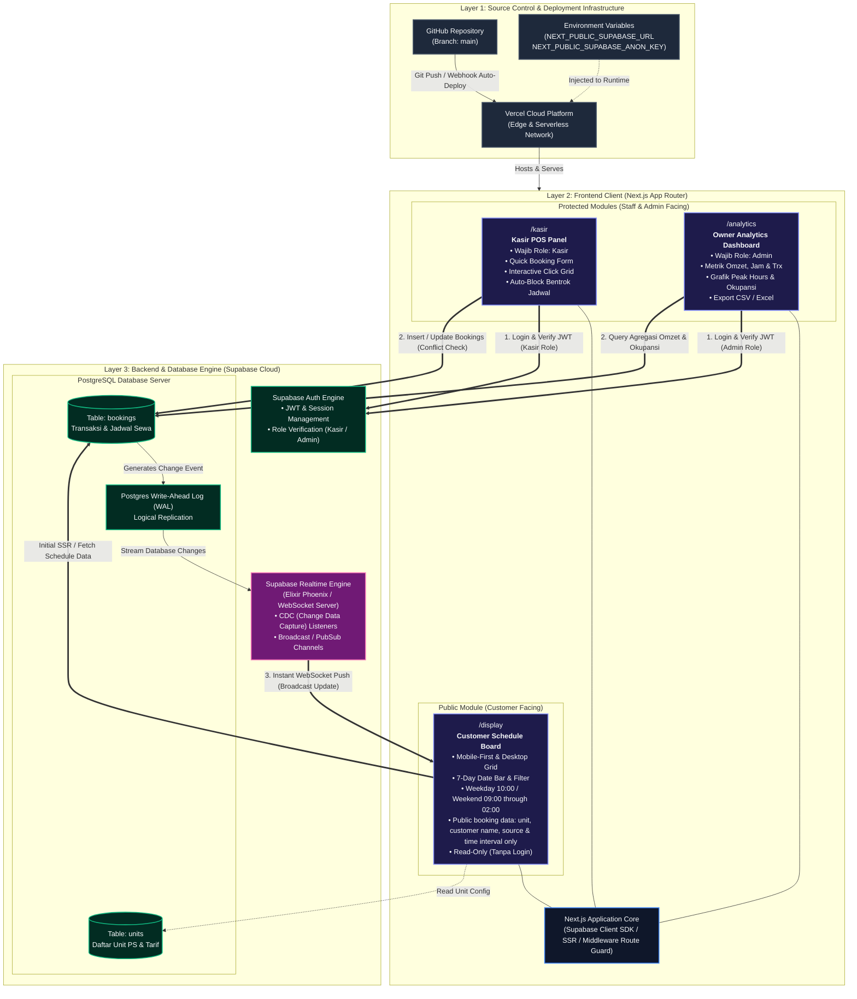
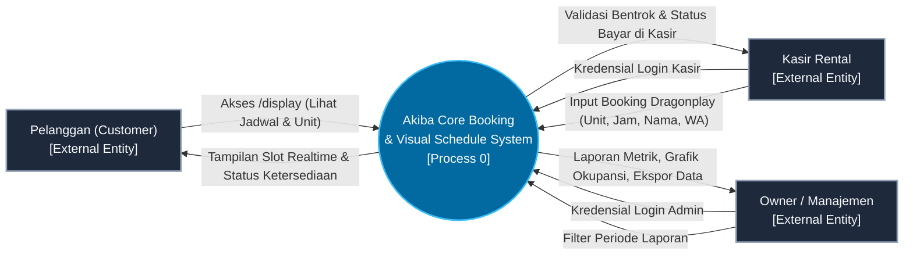
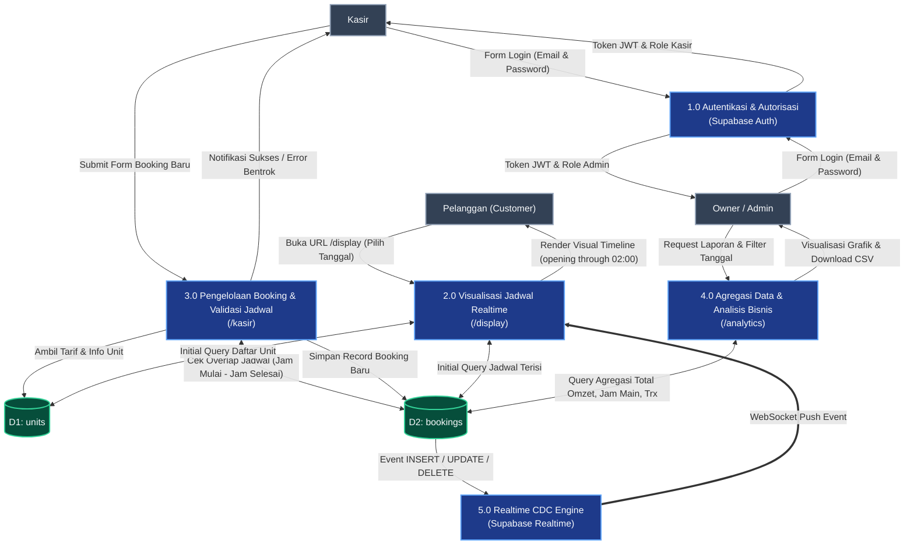
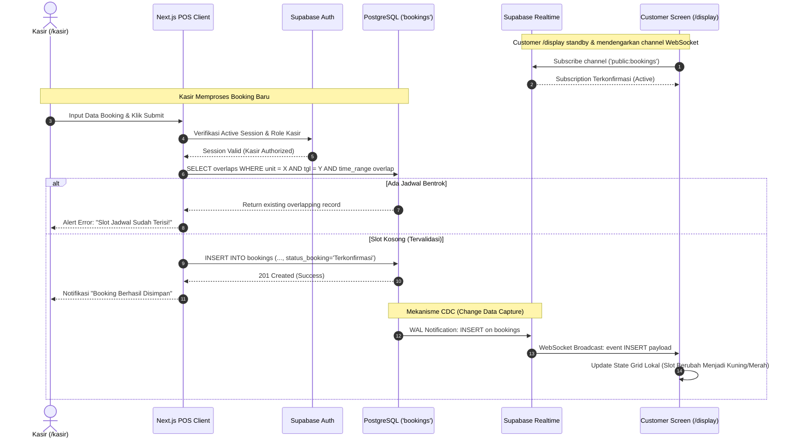
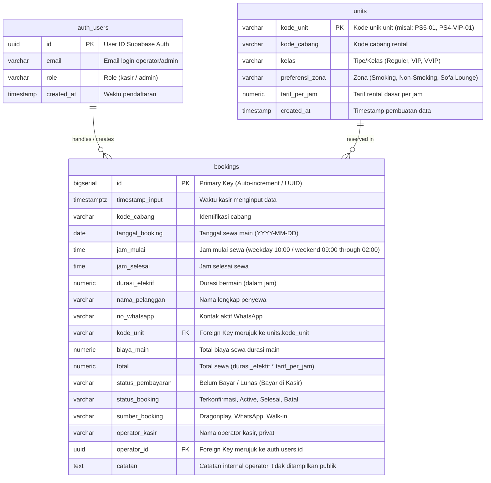

# Dokumentasi Arsitektur Sistem, Alur Data (DFD), & ERD
## Akiba Core Real-Time Booking & Visual Schedule System

Dokumen ini memuat spesifikasi arsitektur teknis, diagram arsitektur tingkat tinggi (High-Level Architecture), Data Flow Diagram (DFD), Diagram Sekuensial Realtime, dan Entity Relationship Diagram (ERD) untuk sistem booking rental PlayStation **Akiba Core**.

---

## 1. High-Level System Architecture Diagram

Diagram berikut menggambarkan 3 layer utama: **Deployment & CI/CD**, **Frontend Layer (Next.js on Vercel)**, dan **Backend/Database Layer (Supabase PaaS)** beserta garis hubungan antar komponen.



---

## 2. Data Flow Diagram (DFD)

### DFD Level 0 (Context Diagram)
Diagram Konteks menggambarkan batasan sistem dan entitas eksternal yang berinteraksi langsung dengan Akiba Core System.



---

### DFD Level 1 (Decomposition Diagram)
Menjelaskan aliran data terperinci di antara proses, data store, dan entitas.



---

### Real-Time Data Flow Sequence Diagram
Mengilustrasikan bagaimana proses booking di `/kasir` memicu update seketika pada tampilan `/display` pelanggan melalui Supabase Realtime WebSocket:



---

## 3. Entity Relationship Diagram (ERD)

Database menggunakan PostgreSQL pada Supabase. Relasi antar tabel dirancang untuk menjaga integritas referensial dan performa agregasi query analytics.



---

## 4. Spesifikasi Kamus Data (Data Dictionary)

### Tabel 1: `units`
Tabel master untuk mengelola unit konsol PlayStation yang disewakan.

| Kolom | Tipe Data | Constraint | Keterangan |
| :--- | :--- | :--- | :--- |
| `kode_unit` | `VARCHAR(30)` | **PRIMARY KEY** | Identifier unik unit (contoh: `PS5-VIP-01`). |
| `kode_cabang` | `VARCHAR(20)` | `NOT NULL` | Kode identitas cabang operasional. |
| `kelas` | `VARCHAR(30)` | `NOT NULL` | Kategori konsol (`PS5 Standard`, `PS5 VIP`, `PS4 Pro`). |
| `preferensi_zona` | `VARCHAR(50)` | `NOT NULL` | Ruangan (`VIP Room AC`, `Smoking Area`, `Non-Smoking`). |
| `tarif_per_jam` | `NUMERIC(10,2)` | `NOT NULL, CHECK (tarif_per_jam > 0)` | Harga sewa per jam. |
| `created_at` | `TIMESTAMPTZ` | `DEFAULT NOW()` | Waktu data dibuat. |

---

### Tabel 2: `bookings`
Tabel transaksi utama yang menyimpan jadwal dan rincian finansial sewa.

| Kolom | Tipe Data | Constraint | Keterangan |
| :--- | :--- | :--- | :--- |
| `id` | `BIGSERIAL` / `UUID` | **PRIMARY KEY** | Identifier transaksi unik. |
| `timestamp_input` | `TIMESTAMPTZ` | `DEFAULT NOW()` | Waktu saat form disubmit di POS kasir. |
| `kode_cabang` | `VARCHAR(20)` | `NOT NULL` | Cabang lokasi booking. |
| `tanggal_booking` | `DATE` | `NOT NULL` | Tanggal reservasi. |
| `jam_mulai` | `TIME` | `NOT NULL` | Waktu mulai sewa (misal: `14:00:00`). |
| `jam_selesai` | `TIME` | `NOT NULL` | Waktu selesai sewa (misal: `16:00:00`). |
| `durasi_efektif` | `NUMERIC(4,2)` | `NOT NULL` | Lama main dalam jam (misal: `2.00`). |
| `nama_pelanggan` | `VARCHAR(100)` | `NOT NULL` | Nama penyewa. |
| `no_whatsapp` | `VARCHAR(25)` | `NOT NULL` | Nomor kontak WhatsApp pelanggan. |
| `kode_unit` | `VARCHAR(30)` | **FOREIGN KEY** | Terhubung ke `units.kode_unit` (`ON DELETE RESTRICT`). |
| `biaya_main` | `NUMERIC(12,2)` | `NOT NULL` | `durasi_efektif` $\times$ `tarif_per_jam`. |
| `total` | `NUMERIC(12,2)` | `NOT NULL` | Nilai sewa saja: `durasi_efektif × tarif_per_jam`. |
| `status_pembayaran` | `VARCHAR(40)` | `CHECK IN ('Belum Bayar', 'Lunas (Bayar di Kasir)')` | Pembayaran dilakukan langsung di kasir. |
| `status_booking` | `VARCHAR(20)` | `CHECK IN ('Terkonfirmasi', 'Active', 'Selesai', 'Batal')` | Status sesi rental. |
| `sumber_booking` | `VARCHAR(30)` | `CHECK IN ('Dragonplay', 'WhatsApp', 'Walk-in')` | Kanal sumber reservasi. |
| `operator_kasir` | `VARCHAR(30)` | Wajib untuk booking baru | Nama operator kasir; hanya ditampilkan di detail internal. |
| `operator_id` | `UUID` | **FOREIGN KEY** | Kasir pencatat transaksi (merujuk ke `auth.users.id`). |
| `catatan` | `TEXT` | `NULL` | Catatan internal, hanya dapat dilihat operator. |

---

## 5. Ringkasan Fitur & Logika Validasi

1. **Smart Validation (Pencegahan Overlap Jadwal)**:
   - Sebelum record disimpan ke tabel `bookings`, sistem mengeksekusi query validasi bentrok:
   ```sql
   SELECT id FROM bookings
   WHERE kode_unit = :kode_unit
     AND tanggal_booking = :tanggal_booking
     AND status_booking IN ('Terkonfirmasi', 'Active')
     AND (
       (jam_mulai < :jam_selesai AND jam_selesai > :jam_mulai)
     );
   ```
   - Jika record ditemukan, transaksi ditolak dan kasir menerima notifikasi instan.

2. **Supabase Realtime Replication Config**:
   - Tabel `bookings` ditambahkan ke publication Supabase Realtime:
   ```sql
   ALTER PUBLICATION supabase_realtime ADD TABLE bookings;
   ```
   - Client `/display` mendengarkan event via:
   ```typescript
   supabase
     .channel('public:bookings')
     .on('postgres_changes', { event: '*', schema: 'public', table: 'bookings' }, (payload) => {
       updateTimelineGrid(payload);
     })
     .subscribe();
   ```

3. **Color-Coded Status di `/display`**:
   - 🟢 **Kosong (Available)**: Tidak ada booking pada rentang slot jam tersebut.
   - 🔵 **Terkonfirmasi**: Terjadwal untuk waktu mendatang.
   - 🟢 **Active (Sedang Main)**: Waktu sekarang berada di antara `jam_mulai` dan `jam_selesai`.
   - ⚪ **Selesai**: Sesi main telah berakhir.
